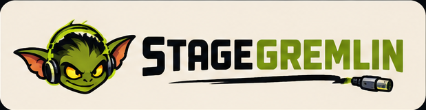
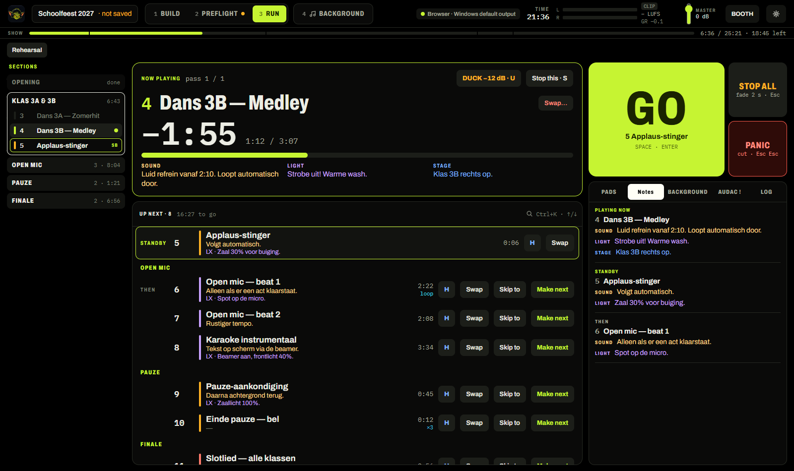
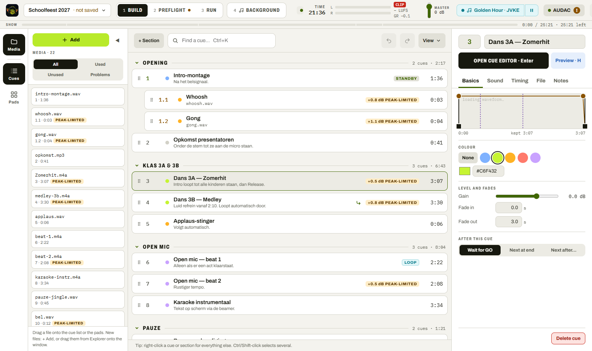
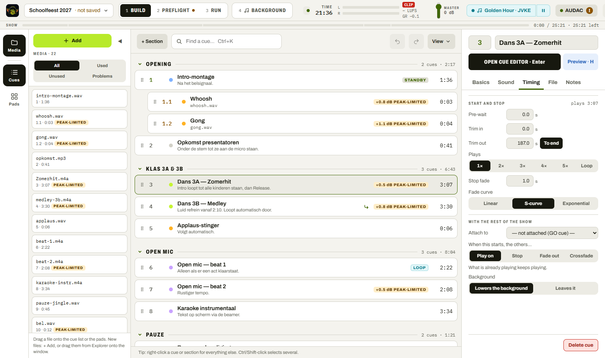
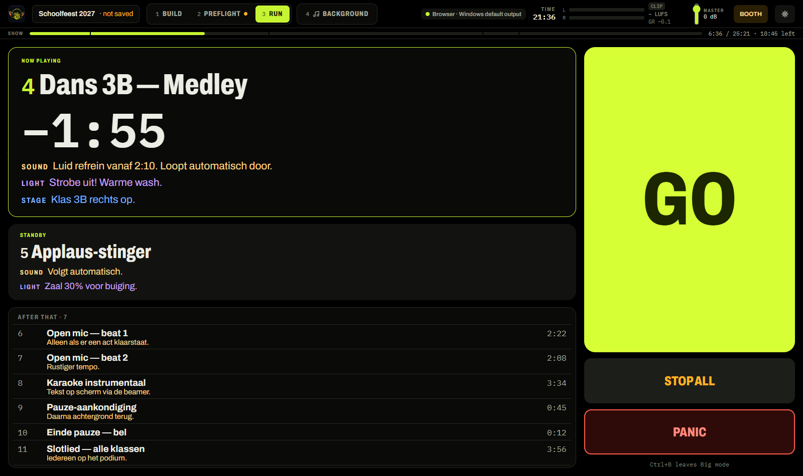
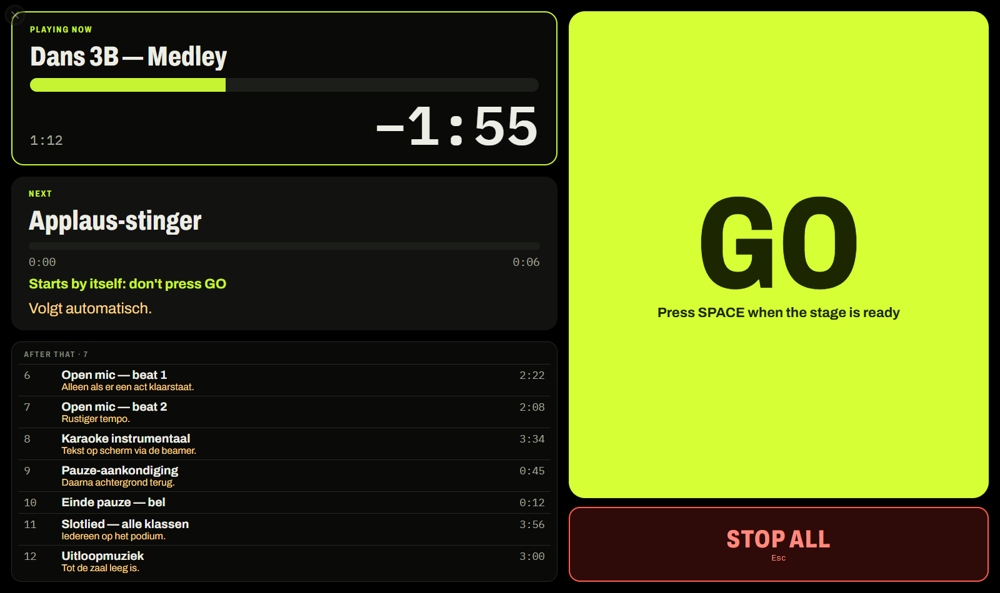
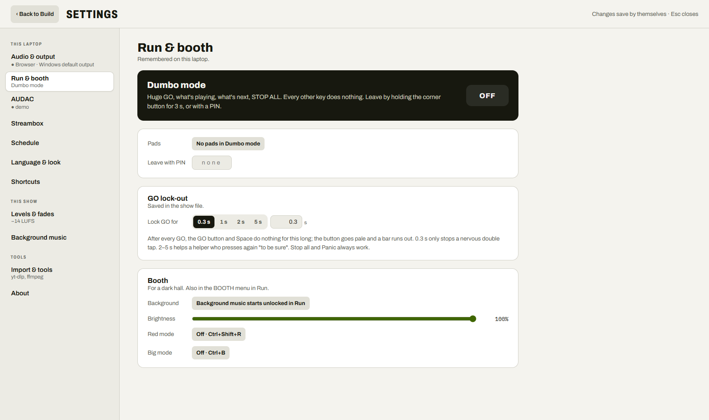

<p align="center">
  <picture>
    <source media="(prefers-color-scheme: dark)" srcset="docs/brand/stagegremlin-lockup-dark.png">
    
  </picture>
</p>

<p align="center">
  <b>A cue player for school shows on Windows.</b><br>
  Build the show at home, check the rig before the doors open, run it from the booth with the spacebar as GO.
</p>

<p align="center">
  <a href="https://github.com/RareGoudvis/StageGremlin/releases/latest"><b>Download the latest build</b></a>
  · Windows 10/11 · no admin rights needed
</p>



StageGremlin plays a list of sound cues, one GO at a time, into one stereo feed to the mixing desk (an Allen & Heath
Qu-24 over USB at our school; any Windows output works). It's made for the people who actually run school shows:
a teacher who set the show up, and on the night maybe a pupil or a parent who has never touched a sound desk.

## What it does

- **Every song equally loud.** Each file is measured when you add it (EBU R128) and matched to −14 LUFS, without
  ever pushing a peak over −1 dBTP. A limiter on the output catches the rest.
- **GO is the spacebar.** Esc stops everything with a fade; Esc twice is Panic. A GO lock-out (0.3–10 s) stops a
  nervous double tap from skipping a cue.
- **Cues that do things by themselves**: pre-wait, "next at end" or "next after n seconds", cues attached to a moment
  inside another cue, play 1–5 times or loop, vamps (loop a part until you release it), and per cue what happens to
  what's already playing: play on, stop, fade out or crossfade.
- **Pads** for applause, a gong, a drum roll: keys 1–9 and 0, one-shot, toggle or loop.
- **Fix it live**: Duck (U) drops the music while someone talks, Make next / Skip to (also for cues already played, if
  someone pressed GO too early), emergency file swap, headphone preview, pause everything (P).
- **Background music** for before the show and the break (YouTube, SoundCloud, Spotify… in their own window), lowered
  automatically while a cue plays.
- **Preflight** checks the rig before the doors open: output device, missing or unreadable files, test tones to set
  the desk's gain.
- **Big mode** and **Dumbo mode** for someone who has never run sound (see below).
- AUDAC MTX zone control and a schedule for the school's speakers, a printed cue sheet, Dutch and English.

## A quick tour

**Build**: add files (or YouTube links), put them in order in sections, set fades and what happens next. Each cue is
a card; the inspector on the right has the details.



The Timing tab: pre-wait, trims, how many times it plays, and what happens to the others when this cue starts.



**Run** is locked (no editing during the show) and black for a dark booth. Above: now playing with its notes,
up next with Make next / Skip to, GO, and a dock with pads, notes, background music and the log.

**Big mode** (Ctrl+B): just what plays, what stands by and the rest of the show, as large as it goes.



**Dumbo mode**: for a helper who has never run sound. One huge GO, Stop all, what plays now with a timeline, what's
next ("starts by itself: don't press GO" when it follows on), and the rest of the show. Every other key does
nothing; leaving takes a 3-second hold or a PIN.



**Settings** save as you change them. What belongs to this laptop (output, language, shortcuts) stays on the laptop;
what belongs to the show (levels, GO lock-out, background music) travels in the show file.



## Using it

1. Download `StageGremlin-portable.zip` from the [latest release](https://github.com/RareGoudvis/StageGremlin/releases/latest),
   right-click it → Properties → **Unblock**, unzip, run `StageGremlin.exe`. Everything (settings, sign-ins) stays in
   that folder, so you can carry it on a USB stick. Prefer an installer? Take `StageGremlin-setup.exe` instead.
2. **Build**: + Add (Ctrl+I) your audio files, or drag them from Explorer onto the window. Save the show (Ctrl+S): the
   show folder gets a `media/` folder with copies of every file, so the folder is all you need on the show laptop.
3. **Preflight** on the day: pick the output, play the pink-noise tone and set the desk's channel so its meter sits
   at 0. Fix anything red.
4. **Run**: Space = GO.

The app tells you when a newer build is on GitHub (banner in Build, or Settings › About). Nothing installs by itself.

### Keys in Run

| Key | What it does |
|---|---|
| Space (or Enter) | GO |
| Esc · Esc Esc | Stop all (with a fade) · Panic (cut at once) |
| S | Stop the cue that's playing |
| U | Duck the playing cue (press again to bring it back) |
| V | Release a vamp |
| P | Pause / resume everything |
| H | Preview the selected cue in the headphones |
| Ctrl+K | Find a cue |
| Ctrl+B | Big mode |
| D · R | Background music: lower · restore |
| 1–9, 0 | Pads |

All keys can be changed in Settings › Shortcuts.

## Status

Version 1.0. A real show has been played with it over the laptop's aux output, and the AUDAC MTX88 zone control has
been used on the school's own system. Still to come: one run on the Qu-24 over USB.
[`docs/TESTING.md`](docs/TESTING.md) is the test plan.

---

## For developers

Rust (playback engine on [kira](https://github.com/tesselode/kira), loudness with symphonia + ebur128) in a
[Tauri 2](https://tauri.app) shell, UI in React + TypeScript (Vite, Zustand).

- Spec: [`docs/brief.md`](docs/brief.md) · how the parts talk: [`docs/ipc.md`](docs/ipc.md) · notes for Claude Code:
  [`CLAUDE.md`](CLAUDE.md)
- `crates/engine/`: show model, playback, limiter, analysis, engine tests on a fake sound card
- `src-tauri/`: engine thread, commands, output devices, background player windows, AUDAC
- `src/`: the UI; texts per area in `src/lang/` (English + Dutch)

### First time on a Windows PC

You need admin rights for these installs, so do this on your own PC, not the school laptop.

1. **Rust** from <https://rustup.rs> (`rustup-init.exe`, accept the defaults; let it install the Visual Studio C++
   Build Tools, workload "Desktop development with C++").
2. **Node.js 22 LTS** from <https://nodejs.org>.
3. WebView2 is already part of Windows 10/11.

Keep the project *outside* OneDrive (OneDrive and `node_modules`/`target` don't mix well).

### Run and test

```
npm install
npm run tauri dev               # the app, with hot reload (first run compiles Rust for a few minutes)
npm run dev                     # the UI alone in a browser: real sound via Web Audio, no Windows-only parts
cargo test -p cueplay-engine    # playback tests on a fake sound card
npx vitest run                  # UI logic tests
npm run build                   # type-check + build the UI
```

### Releases

Releases are built on the laptop and uploaded to GitHub:

```
git push origin main
powershell -ExecutionPolicy Bypass -File scripts/release.ps1
```

This runs the checks (UI type-check + build, UI tests, Rust tests, clippy; if one fails, no release is made), builds
`StageGremlin-portable.zip` and `StageGremlin-setup.exe` into `release-out\`, and publishes them as
`v<version>-build.<N>` (from 1.0 on marked *latest*). `-NoPublish` only builds; `-FreshTools` downloads yt-dlp and
ffmpeg again. Needs the GitHub CLI logged in (`gh auth login`) and the admin-password hash in `.env.local`
(`node scripts/make-admin-hash.mjs`).

Backup: **Actions → Build Windows → Run workflow** on GitHub builds the same thing in the cloud. Cloud builds have no
shared admin password, so each install asks for its own.

### Keep building with Claude Code

Open this folder in Claude Code and start with *"Read CLAUDE.md and docs/brief.md, then continue with the next
milestone."* `CLAUDE.md` lists what's done and what's next.

## Bundled

Release builds include yt-dlp, ffmpeg and [uBlock Origin Lite](https://github.com/uBlockOrigin/uBOL-home) (GPL-3.0,
for the background player window: it cleans up the players' pages, not their audio/video ads). Each keeps its own
licence.

## License

AGPL-3.0-or-later.
